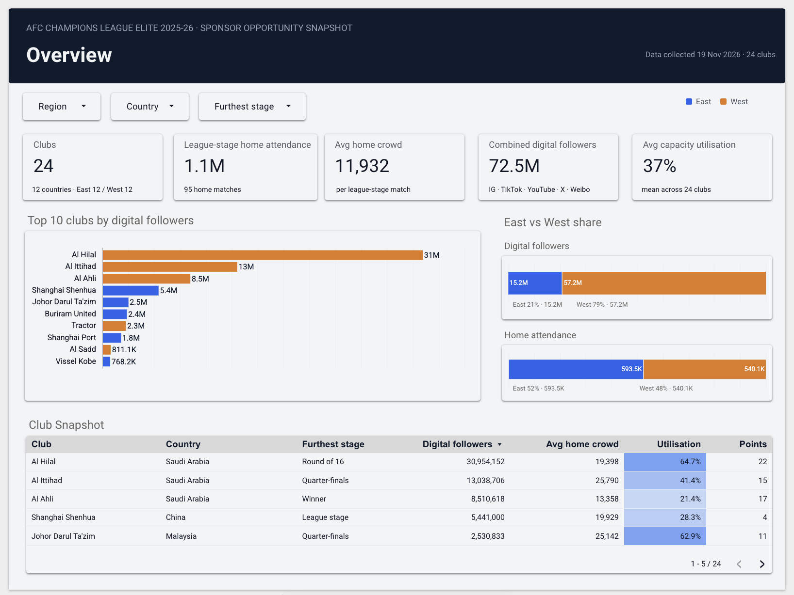

# ACL Elite Sponsor Opportunity Snapshot

**Which AFC Champions League Elite 2025/26 clubs and countries give a sponsor
the biggest fan reach, in the stadium and online?**

This repo builds a clean, sourced dataset of the 24 league-stage clubs. It
combines home attendance, stadium capacity, results and social-media followers,
and feeds a Looker Studio dashboard.

**Dashboard:** [Looker Studio – ACL Elite Sponsor Opportunity Snapshot](https://datastudio.google.com/reporting/4fda81c4-ee2d-4979-84aa-d41bf6cd5bfe)



The dashboard has five pages. All of them filter by region, country and
furthest stage:

| Page | What it shows |
|---|---|
| [Overview](images/01_overview.png) | Headline KPIs, top 10 clubs by followers, East vs West share, club table |
| [Matchday reach](images/02_matchday_reach.png) | Average home crowd, capacity utilisation, biggest single crowds |
| [Digital reach](images/03_digital_reach.png) | Followers by platform per club, platform mix, followers per stadium fan |
| [Opportunity matrix](images/04_opportunity_matrix.png) | Crowd vs digital reach scatter (log scale), with clubs grouped into 4 quadrants: complete package, digital-first, stadium strongholds, niche |
| [Club profile](images/05_club_profile.png) | One club in detail: platforms, league-stage record, stadium |

---

## Key insights

1. **Digital reach is concentrated in Saudi Arabia.** The three Saudi clubs
   hold 52.5M of the 72.5M followers in the competition (72%). Al Hilal alone
   has 31.0M (43%), with about 1,600 followers per fan in its stadium. A
   sponsor looking for reach online gets the most from one Saudi deal.

2. **The biggest crowds are not the biggest online audiences.** Chengdu
   Rongcheng had the highest average home crowd (37,267, 74% of capacity) but
   only 509K followers (14 per fan), and Tractor drew 36,085 per match. These
   clubs suit matchday activation (perimeter boards, in-stadium sampling)
   rather than a social-led campaign. In China that campaign also has to run
   on Weibo, not on the global platforms.

3. **Southeast Asia gives more than Japan and Korea on both measures.** Johor
   Darul Ta'zim and Buriram United averaged 20,996 fans per home match and
   have 4.9M followers between them, and both reached the quarter-finals. The
   six Japanese and Korean clubs averaged 5,850 fans and have 2.2M followers
   combined, despite Machida Zelvia reaching the final.

---

## Data sources

| What | Source | How |
|---|---|---|
| Matches, attendance, venues | Wikipedia ACL Elite pages, pinned to a fixed revision. Each attendance cites the official **the-afc.com match report**, kept per match. | Downloaded with `scripts/fetch_raw.sh` |
| League tables, results | Wikipedia (pinned revision) | Same |
| Stadium capacity | **Transfermarkt** ACL Elite attendance table; Wikipedia stadium infobox when the stadium is missing there | Same |
| Attendance cross-check | Transfermarkt attendance by stadium | Same |
| Official social accounts | Club homepages, Wikidata, YouTube search | `scripts/fetch_social_handles.py`, `scripts/lookup_youtube_channels.py` |
| Follower counts | Instagram, TikTok, YouTube, X; Weibo for the 3 mainland-China clubs | **Collected by hand** on 2026-11-19, because the platforms block automated access |

Every number in the output has a source URL and a collection date in the
`sources` sheet of the Excel file. Sources that were blocked
(worldfootball.net, the AFC site's JavaScript pages) are listed in
[`data/raw/README.md`](data/raw/README.md), with how each raw file was obtained.

## Method

- **Attendance** counts league-stage **home** matches only (4 per club).
  Matches at neutral venues are excluded, e.g. Tractor's home match moved to
  Doha and the centralised finals in Jeddah. Round-of-16 home legs are in
  separate columns.
- **capacity_utilisation** = average attendance / stadium capacity.
- **total_digital_followers** = Instagram + TikTok + YouTube + X, plus Weibo
  for the China clubs. The global platforms are blocked in China, so Weibo is
  their main channel. It is also reported in its own column.
- **followers_per_fan** = total digital followers / average attendance. It
  shows how far a club's reach goes beyond its stadium.
- Only **official** accounts count: linked from the club's website, recorded
  on Wikidata, or carrying a verified badge. Missing accounts count as 0.
  Unverified accounts are excluded (11 accounts, 495,575 followers). Douyin
  could not be checked, because it needs a Chinese phone login.
- Checks: points recalculated from the 96 match scores match the league table
  for all 24 clubs. Attendance is cross-checked against Transfermarkt.
  Outliers are flagged in a `flag` column (e.g. Al Shorta drew 16,117 in a
  15,443-seat stadium).

Full assumptions, gaps and flags are in the `notes` sheet.

## Repository structure

```
data/raw/          original downloads, untouched (+ README on how they were obtained)
data/reference/    hand-made lookups: stadium name crosswalk, researched handles
data/interim/      values extracted from the raw files, still as text
data/clean/        cleaned tables: matches, clubs, digital_followers, crosscheck
scripts/           pipeline scripts (below)
output/            acl_sponsor_snapshot.xlsx: clubs, countries, sources, notes
images/            dashboard screenshots (one per page)
```

## Re-running the pipeline

```bash
python3 -m venv .venv && source .venv/bin/activate
pip install -r requirements.txt

bash scripts/fetch_raw.sh                    # download raw pages (skips existing files)
python scripts/fetch_social_handles.py       # club websites + Wikidata
python scripts/parse_raw.py                  # raw HTML -> data/interim/
python scripts/clean.py                      # -> data/clean/ + data-quality summary
python scripts/build_excel.py                # -> output/acl_sponsor_snapshot.xlsx
```

`scripts/make_followers_template.py` and `scripts/lookup_youtube_channels.py`
were used once, to prepare the manual follower template.

## Limitations

- Followers are a snapshot from 19 November 2026; they change daily.
- Some platforms round large counts (e.g. "1.2M"); the precision of each count
  is recorded.
- Followers measure reach, not engagement. Followers are global, while
  attendance is local.
- Douyin (Chinese TikTok) is missing, so the China clubs' digital reach is
  understated.
